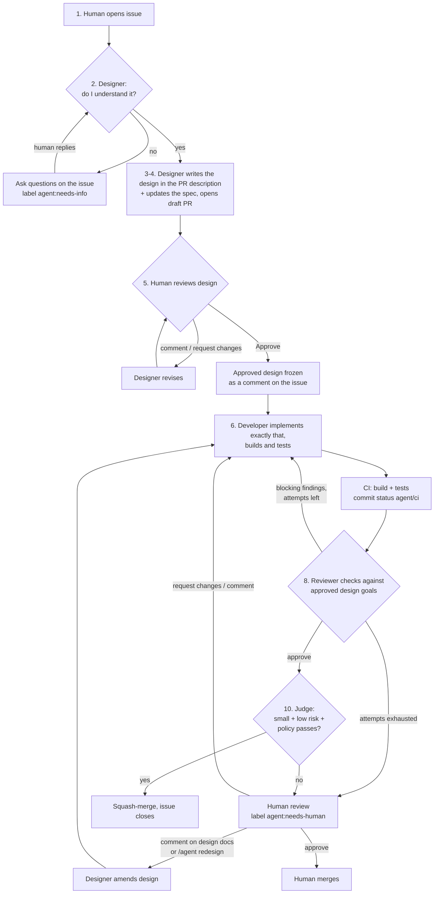

# agent-factory: issue-to-merge agents for GitHub

You open a GitHub issue. Claude agents running in GitHub Actions clarify it,
design it, implement it, review it, and either merge it or hand it to you.

This repo is the shared, versioned factory. A project uses it through a short
workflow file and can override the factory's settings and prompts.



## Adding it to a project

1. **Workflow.** Copy [`examples/agent.yml`](examples/agent.yml) to
   `.github/workflows/agent.yml` in the project.
2. **Settings (optional).** Create `.github/agent/config.json` with only what
   differs from the [defaults](agent/config.json); see
   [`examples/config.json`](examples/config.json) and
   [Customising](#customising-a-project).
3. **Claude token.** Run `claude setup-token` on your machine, then:

   ```sh
   gh secret set CLAUDE_CODE_OAUTH_TOKEN -R <owner>/<project>
   ```

   Usage counts against your Claude subscription. To use an API key instead,
   set `ANTHROPIC_API_KEY`; it is used only when the OAuth token is absent.
4. **Repository settings** in the project:
   - **Settings → Actions → General → Workflow permissions:** read and write,
     with **Allow GitHub Actions to create and approve pull requests** enabled.
   - **Settings → General → Pull Requests:** **Allow squash merging** enabled.
5. **Optional repository variables:**
   - `AGENT_USERS`: comma-separated GitHub logins allowed to drive the agents.
     The default is the repository owner only, so strangers can't spend your
     Claude usage.
   - `AGENT_MODEL`: overrides the model in the config.
   - `AGENT_BUILD_RUNNER`: the runner for the jobs that build and test (develop
     and review). The default is `ubuntu-24.04`; use e.g. `macos-15` for a
     Swift or Xcode project. Routing, design and judge always run on Linux.

Any repository can use the factory, including a public fork. The Claude key
stays in the project's own secrets; the factory never sees anyone else's.

## Customising a project

All overrides live in the project's `.github/agent/` directory and are read
from its **default branch** only, so a PR (or an agent) can't change the rules
it is judged by.

| File | Effect |
|---|---|
| `config.json` | Merged over the factory [`config.json`](agent/config.json): objects merge key by key, arrays and values replace. |
| `prompts/<role>.md` | Replaces the factory prompt for `designer`, `developer`, `reviewer` or `judge`. |
| `prompts/<role>.append.md` | Added after the prompt under *Project-specific instructions*. Prefer this: you keep factory prompt improvements. |

Useful config keys:

| Key | Default | Used for |
|---|---|---|
| `commands.build`, `commands.test` | `./scripts/build.sh`, `./scripts/test.sh` | CI in the review stage, and the only commands the developer and reviewer may run |
| `design.dir`, `design.specFile` | `docs`, `docs/design.md` | where the designer may write, and the living spec checked by the reviewer |
| `judge.*` | 8 files, 300 lines, `.github/**` and `CLAUDE.md` protected, `src/**` / `tests/**` | auto-merge policy |
| `roles.<role>.effort`, `roles.<role>.allowedTools` | see defaults | per-agent settings |
| `model`, `maxDeveloperAttempts` | `claude-opus-5-5`, 3 | |
| `mergeOnHumanApproval` | `true` | squash-merge when a maintainer approves a PR handed to them; `false` = merge by hand |
| `workflowFile` | `agent.yml` | the project workflow the agents dispatch to hand off |

Config strings and prompts can use `{{build}}`, `{{test}}`, `{{designDir}}` and
`{{specFile}}`, which are filled in from the merged config.

The schemas, routing and policy code are not overridable.

## Using it

| You do | What happens |
|---|---|
| Open an issue | The designer either asks questions on the issue or opens a **draft PR** containing the design. |
| Reply on the issue (while it has `agent:needs-info`) | The designer tries again. |
| Comment, or **Request changes** on the design PR | The designer revises the design. It answers inline comments in their own thread. |
| **Approve** the design PR (latest commit) | The design is frozen on the issue and the developer implements it. Then CI runs, then the reviewer. The developer and reviewer loop up to 3 developer attempts. When the reviewer is satisfied, the judge runs. |
| Nothing | The judge auto-merges small, low-risk changes. |
| PR labelled `agent:needs-human` | Review it yourself. **Approve** the latest commit and the workflow squash-merges it (if `agent/ci` is green and it merges cleanly), or comment / **Request changes** to send it back to the developer with a fresh 3-attempt budget. The developer answers each inline thread once, and dismisses your "changes requested" review once it has addressed it; the agents then re-review. |
| Comment or review while the agents are working | Queued (`agent:feedback-queued`). When the running stage finishes, your feedback goes straight to the developer instead of on to the next stage, and it is never auto-merged over. |
| Comment on a design file in a review, or `/agent redesign <what to change>`, once the PR is labelled `agent:needs-human` | The designer amends the approved design, the amendment is frozen on the issue as the new contract, and the developer and reviewer run again against it. |
| `/agent retry` (PR or issue comment) | Re-runs the current stage, for example after a failure. Also resumes after `/agent stop`. |
| `/agent stop` (PR comment) | Pauses the agents on that PR. |
| `/agent start` (issue comment) | Starts the designer on an issue that was opened before setup or by someone else. |
| Label an issue `agent:ignore` | The agents leave that issue alone. |

The PR description always shows the current **phase**, the developer attempt
count, and a link to the last run.

## How it works

- **One reusable workflow, one router.** The project's `agent.yml` receives
  every event and calls [`agent.yml`](.github/workflows/agent.yml) here. Its
  `route` job runs [`core.route()`](agent/lib/core.cjs), a pure, unit-tested
  function that decides which stage to run from the event and the PR's state.
- **State lives in the PR description**, in a hidden
  `<!-- agent-state {...} -->` block: phase, developer attempt, the approved
  design SHA, the reviewed SHA, and the time of the last stage. Labels are only
  notifications.
- **Handoffs.** Events created with the built-in `GITHUB_TOKEN` don't trigger
  workflows, so each stage starts the next one with an explicit
  `workflow_dispatch` of the project's workflow. The router rejects a stale
  handoff if the PR's phase no longer matches.
- **Every stage follows the same shape:** `prepare` (trusted script reads
  GitHub, writes the prompt) → **Claude** → `publish` (trusted script validates
  and commits, pushes, comments, advances state). The scripts run through the
  [`stages`](actions/stages/action.yml) action and Claude through
  [`run-claude`](actions/run-claude/action.yml).
- **The agents** are all Claude Code (`claude -p`) with a role prompt from
  [`prompts/`](agent/prompts), a JSON schema for the result from
  [`schemas/`](agent/schemas), and a per-role tool allowlist:

  | Role | Can edit | Can run |
  |---|---|---|
  | Designer (design phase, or amending on request) | the design dir | read-only git |
  | Developer | everything except the design dir, `.github/`, `CLAUDE.md` | the build and test commands, read-only git |
  | Reviewer | nothing | the build and test commands, read-only git |
  | Judge | nothing | read-only git |

  The publish step enforces the path rules again and fails the stage if they
  are broken.
- **The design contract.** The issue is the request. The designer's proposal
  (request, acceptance criteria, design, test plan, out of scope, assumptions)
  is the PR description, and lasting API/behaviour changes go in the spec file.
  When you **Approve**, the workflow posts a frozen copy of the proposal on the
  issue (📌 *Approved design*). The developer implements that, and the reviewer
  and judge check against it plus the spec at the approved commit. After
  approval the design only changes when a human asks for it; the designer then
  amends it and posts a new frozen copy. Any other doc change after approval
  sends the PR to a human.
- **Maintainers.** Users in `AGENT_USERS` (default: the repo owner) are
  marked `(maintainer)` in the conversation the agents see. Their requests
  that refine the approved design (naming, constants, structure, extra tests)
  are in scope for the developer and reviewer without a redesign. Requests
  that would change behaviour, the API or the acceptance criteria need
  `/agent redesign`.
- **CI.** The review stage runs the build and test commands itself and posts an
  `agent/ci` commit status. A CI failure is always a blocking finding, and
  `agent/ci` is what the judge checks. If the project has its own CI on
  `pull_request`, GitHub holds those runs on agent PRs for approval
  (`action_required`); that is expected.
- **Judge policy.** The judge's recommendation is necessary but not sufficient.
  Auto-merge also requires, enforced by a script: the file and line limits, no
  protected paths, test changes whenever source changed, `agent/ci` green on the
  reviewed SHA, the head unchanged since the review, a cleanly mergeable PR, and
  a `low` risk rating.

## Security model

- **Claude never gets a GitHub token.** Checkouts use
  `persist-credentials: false`. Only the trusted publish scripts push, using
  `GITHUB_TOKEN` scoped per job.
- **The rules can't be changed from a PR.** Factory code comes from this repo at
  the pinned tag; project overrides come from the project's default branch. The
  judge never auto-merges changes under `.github/`.
- **Only allowed users trigger runs.** Issue and PR text is wrapped as
  untrusted data in every prompt.
- **Reviews are posted as comments, not formal approvals**, because GitHub
  doesn't let a PR's author (the bot) approve it. The agents' approval is
  recorded in the PR state.

## Versioning

Projects call `@v1`. The workflow and the actions it uses are all referenced at
`v1`, so a release moves the `v1` tag (and adds an exact `v1.x.y` tag):

```sh
git tag -f v1 && git tag v1.0.1 && git push -f origin v1 v1.0.1
```

Breaking changes to config, prompts or the caller workflow go in `v2`.

## Development

```sh
node --test 'agent/tests/*.test.cjs'   # routing, policy and config logic
actionlint                              # workflow syntax
```

## Known limitations

- Approvals made while an agent stage is running are ignored; approve once the
  PR is labelled `agent:needs-human`.
- If the default branch moves and the PR conflicts, the judge hands the PR to a
  human. No agent rebases.
- The workflow can't yet be overridden per project, only settings and prompts.
